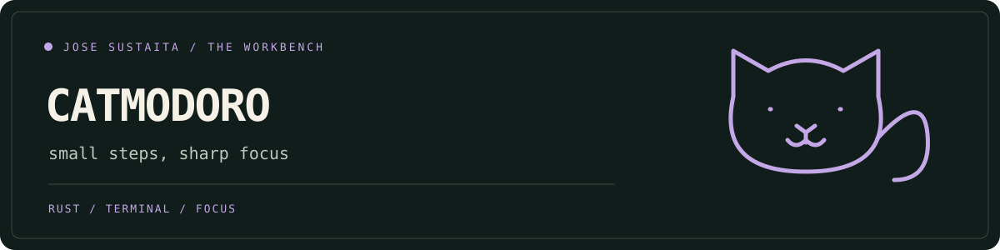

<p align="center"></p>

# Catmodoro 🐾

A Rust Pomodoro timer with a tiny animated cat keeping you company. Set a focus session, pause for interruptions, and finish with a purr.

## One-command start

Install **Docker with Compose v2**, open a terminal, and run:

```bash
git clone --depth 1 https://github.com/josesustaita/catmodoro.git
cd catmodoro
./scripts/bootstrap.sh
```

The script builds the image, runs the tests, and opens a 25-minute session. The first build downloads the Rust toolchain; later launches reuse Docker's cache. No local Rust installation is needed. Docker Desktop must be running on macOS/Windows; use Bash or WSL for the script.

```bash
./scripts/bootstrap.sh -d 15              # a shorter session
./scripts/bootstrap.sh --no-animation     # a still companion
./scripts/bootstrap.sh --help
./scripts/bootstrap.sh doctor             # check Docker and Compose
./scripts/bootstrap.sh test               # tests + noninteractive CLI smoke check
```

## Keys & behavior

| Key                     | Action                             |
| ----------------------- | ---------------------------------- |
| `p` or `space`          | Pause/resume the countdown and cat |
| `r`                     | Restart the current session        |
| `a`                     | Toggle the cat animation           |
| `q`, `Esc`, or `Ctrl+C` | Exit and restore your terminal     |

Sessions accept **1–1440 whole minutes**. The timer stays open at completion so you can restart or quit. Remaining time saturates at zero, and paused time is excluded. The cat's movement is decorative: all controls and timer states work without animation.

## Run with Rust

```bash
cargo run --locked -- -d 25
cargo run --locked -- --no-animation
cargo test --locked
cargo fmt --check
cargo clippy --locked --all-targets -- -D warnings
```

The Docker build uses Rust 1.90 and a small Debian runtime running as a non-root user. It requires no network access after the image is built, no API keys, and no persistent storage.

## Project map

- `src/main.rs` — timer state, keyboard handling, terminal rendering, and regression tests.
- `Dockerfile` / `compose.yaml` — build and interactive runtime.
- `scripts/bootstrap.sh` — Docker checks and launch commands.
- `docs/banner.svg` — local animated artwork; respects reduced-motion preferences.

## Troubleshooting

- **“Use an interactive terminal”**: the timer needs a TTY. Run it directly in your terminal; use `test` in CI. With Docker directly, pass `-it`.
- **Docker connection error**: start the daemon and run `./scripts/bootstrap.sh doctor`.
- **Strange colors**: try `TERM=xterm-256color ./scripts/bootstrap.sh`.
- **Want to stop?** Press `q`. The container is removed on exit; the cached image remains for the next session.

Pull requests are welcome. Include a short description and the output of the Rust checks above.
